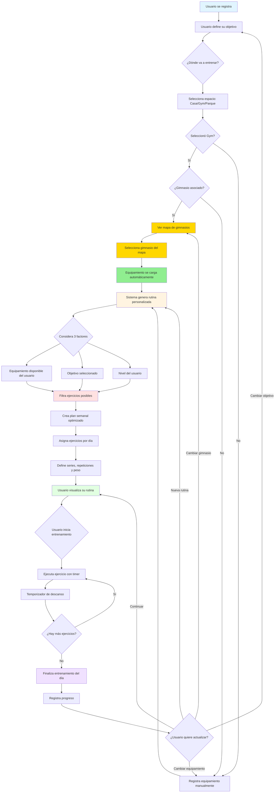

# ExersAI - Sistema de Entrenamiento Personalizado

## 📋 Especificación del Sistema

ExersAI es una aplicación de entrenamiento personalizado que adapta las rutinas de ejercicio a las necesidades y recursos de cada usuario. El sistema considera tres factores principales:

1. **Equipamiento disponible**: El usuario puede entrenar en diferentes espacios (gimnasio, casa, parque, hotel) y el sistema adapta los ejercicios según el equipamiento que tenga disponible en cada lugar.

2. **Nivel del usuario**: La aplicación ajusta la intensidad y complejidad de los ejercicios según la experiencia y capacidad física del usuario.

3. **Objetivo personal**: El sistema personaliza las rutinas según la meta del usuario:
   - **Hipertrofia**: Crecimiento muscular
   - **Fuerza**: Aumento de la fuerza máxima
   - **Resistencia**: Mejora de la capacidad cardiovascular y resistencia muscular

### Estado Actual

✅ **Implementado**:

- Base de datos completa con estructura relacional
- Catálogo de ejercicios y equipamiento
- Sistema de inventario personalizado por usuario y espacio (usando gemini)
- Gestión de grupos musculares

### 🚀 Planes Futuros

- **Splits de ejercicio predeterminados**: Plantillas de rutinas probadas (Push/Pull/Legs, Upper/Lower, Full Body, etc.)
- **Modo de entrenamiento en vivo**:
  - Contador de tiempo por ejercicio
  - Temporizador de descanso entre series
  - Seguimiento del progreso en tiempo real
- **Módulo de nutrición**:
  - Recetas saludables personalizadas
  - Planes de alimentación basados en objetivos
  - Contador de calorías y macronutrientes
- **Guía de forma con IA**:
  - Análisis con cámara para verificar la ejecución correcta
  - Feedback en tiempo real sobre la postura
  - Especialmente útil para ejercicios en casa
- **Red de Gimnasios Asociados** _(Marketing Strategy)_:
  - Alianzas con gimnasios locales para promoción cruzada
  - Gimnasios publican nuestra app a sus miembros
  - A cambio, ExersAI promociona dichos gimnasios en la app
  - Usuarios pueden seleccionar gimnasios asociados desde un mapa interactivo
  - Al seleccionar un gimnasio asociado, todo su equipamiento se carga automáticamente
  - Beneficio mutuo: gimnasios obtienen visibilidad, usuarios obtienen configuración instantánea

---

## 🗄️ Esquema de Base de Datos

La base de datos está organizada en dos grupos principales: **Tablas Maestras** (catálogos públicos) y **Tablas de Usuario** (datos personalizados).

### 1️⃣ Tablas Maestras (Catálogos Públicos)

#### Tabla: `espacios`

Define los tipos de lugares donde se puede entrenar.

| Columna  | Tipo          | Descripción                                               |
| -------- | ------------- | --------------------------------------------------------- |
| `id`     | Número (auto) | Identificador único                                       |
| `nombre` | Texto         | Nombre del espacio (Ej: 'Gym', 'Casa', 'Parque', 'Hotel') |

**Ejemplos de datos**:

- Gym
- Casa
- Parque_calistenia

---

#### Tabla: `catalogo_equipamiento`

Biblioteca completa de todo el equipamiento disponible (independiente del usuario).

| Columna             | Tipo            | Descripción                                            |
| ------------------- | --------------- | ------------------------------------------------------ |
| `id`                | Número (auto)   | Identificador único                                    |
| `nombre`            | Texto           | Nombre del equipo (Ej: 'Mancuernas', 'Barra Olímpica') |
| `imagen_url`        | Texto           | URL de la imagen del equipo                            |
| `grupos_musculares` | Lista de textos | Músculos que trabaja este equipo                       |
| `es_peso_corporal`  | Verdadero/Falso | Indica si no requiere equipamiento externo             |
| `created_at`        | Fecha y hora    | Fecha de registro                                      |

**Ejemplos de datos**:

- Mancuernas
- Barra Olímpica
- Máquina de Press de Pecho
- Bandas de Resistencia
- Peso Corporal

---

#### Tabla: `ejercicios`

Catálogo de todos los ejercicios disponibles en la aplicación.

| Columna                     | Tipo            | Descripción                          |
| --------------------------- | --------------- | ------------------------------------ |
| `id`                        | Número (auto)   | Identificador único                  |
| `nombre`                    | Texto           | Nombre del ejercicio                 |
| `equipamiento_necesario_id` | Número          | Referencia al equipamiento requerido |
| `grupos_musculares`         | Lista de textos | Músculos que se trabajan             |
| `instrucciones`             | Texto           | Descripción paso a paso              |
| `video_url`                 | Texto           | URL del video tutorial               |
| `created_at`                | Fecha y hora    | Fecha de registro                    |

**Ejemplos de datos**:

- Press de Banca (requiere Barra Olímpica, trabaja Pecho/Tríceps/Hombros)
- Flexiones (peso corporal, trabaja Pecho/Tríceps)
- Sentadillas con Mancuernas (requiere Mancuernas, trabaja Piernas/Glúteos)

---

#### Tabla: `gimnasios_asociados`

Gimnasios registrados en la plataforma con su equipamiento completo (para alianzas de marketing).

| Columna      | Tipo            | Descripción                                 |
| ------------ | --------------- | ------------------------------------------- |
| `id`         | Número (auto)   | Identificador único                         |
| `nombre`     | Texto           | Nombre del gimnasio (Ej: 'PowerGym Centro') |
| `direccion`  | Texto           | Dirección física del gimnasio               |
| `latitud`    | Decimal         | Coordenada de latitud para mostrar en mapa  |
| `longitud`   | Decimal         | Coordenada de longitud para mostrar en mapa |
| `telefono`   | Texto           | Teléfono de contacto                        |
| `logo_url`   | Texto           | URL del logo del gimnasio                   |
| `horarios`   | Texto           | Horarios de apertura                        |
| `sitio_web`  | Texto           | URL del sitio web del gimnasio              |
| `activo`     | Verdadero/Falso | Indica si la asociación está activa         |
| `created_at` | Fecha y hora    | Fecha de registro en la plataforma          |

**Uso en Marketing**:

- Estos gimnasios aparecen en un mapa interactivo cuando el usuario selecciona "Gym" como espacio
- Al seleccionar un gimnasio del mapa, su equipamiento se carga automáticamente
- Es una relación win-win: el gimnasio gana visibilidad, el usuario gana conveniencia

---

#### Tabla: `gimnasio_equipamiento`

Relación entre gimnasios asociados y su equipamiento disponible.

| Columna       | Tipo          | Descripción                              |
| ------------- | ------------- | ---------------------------------------- |
| `id`          | Número (auto) | Identificador único                      |
| `gimnasio_id` | Número        | Referencia al gimnasio asociado          |
| `equipo_id`   | Número        | Referencia al equipamiento del catálogo  |
| `cantidad`    | Número        | Cantidad de unidades disponibles         |
| `observacion` | Texto         | Notas adicionales (Ej: 'Solo en piso 2') |

**Ejemplo de uso**:

- Gimnasio "PowerGym Centro" tiene 20 Mancuernas, 5 Barras Olímpicas, 10 Máquinas de Press
- Cuando un usuario selecciona este gimnasio, todo este equipamiento se asocia automáticamente a su inventario

---

### 2️⃣ Tablas de Usuario (Datos Personalizados)

#### Tabla: `usuarios`

Información básica de cada usuario registrado.

| Columna      | Tipo         | Descripción                                                    |
| ------------ | ------------ | -------------------------------------------------------------- |
| `id`         | UUID         | Identificador único del usuario                                |
| `username`   | Texto        | Nombre de usuario                                              |
| `correo`     | Texto        | Correo electrónico                                             |
| `meta`       | Texto        | Objetivo del usuario ('hipertrofia', 'fuerza' o 'resistencia') |
| `created_at` | Fecha y hora | Fecha de registro                                              |

---

#### Tabla: `inventario_usuario`

Equipamiento que cada usuario tiene disponible en cada espacio.

| Columna                  | Tipo          | Descripción                             |
| ------------------------ | ------------- | --------------------------------------- |
| `id`                     | Número (auto) | Identificador único                     |
| `usuario_id`             | UUID          | Referencia al usuario                   |
| `espacio_id`             | Número        | Referencia al espacio (Casa, Gym, etc.) |
| `equipo_id`              | Número        | Referencia al equipamiento del catálogo |
| `cantidad`               | Número        | Cantidad de unidades disponibles        |
| `peso_maximo_disponible` | Texto         | Peso máximo (Ej: '20kg')                |

**Ejemplo de uso**:

- Usuario "Juan" tiene 2 Mancuernas en Casa con peso máximo de 15kg
- Usuario "Juan" tiene acceso a Barra Olímpica en Gym con peso máximo de 100kg

---

#### Tabla: `planes_semanales`

Planes de entrenamiento organizados por día de la semana.

| Columna      | Tipo          | Descripción                               |
| ------------ | ------------- | ----------------------------------------- |
| `id`         | Número (auto) | Identificador único                       |
| `usuario_id` | UUID          | Referencia al usuario                     |
| `nombre`     | Texto         | Nombre del plan (Ej: 'Rutina Upper Body') |
| `dia_semana` | Número        | Día de la semana (1=Lunes, 7=Domingo)     |
| `created_at` | Fecha y hora  | Fecha de creación                         |

---

#### Tabla: `plan_ejercicios`

Contenido detallado de cada plan: qué ejercicios hacer y cómo.

| Columna              | Tipo          | Descripción                               |
| -------------------- | ------------- | ----------------------------------------- |
| `id`                 | Número (auto) | Identificador único                       |
| `plan_id`            | Número        | Referencia al plan semanal                |
| `ejercicio_id`       | Número        | Referencia al ejercicio                   |
| `orden`              | Número        | Orden de ejecución en la rutina           |
| `series`             | Número        | Cantidad de series a realizar             |
| `repeticiones`       | Texto         | Rango de repeticiones (Ej: '8-12')        |
| `peso_sugerido`      | Texto         | Peso recomendado (Ej: '10kg')             |
| `notas_analisis_llm` | Texto         | Notas generadas por IA sobre el ejercicio |

---

## 🔄 Flujo del Sistema

### Descripción del Flujo

1. **Registro e Inicio**: El usuario se registra y define su objetivo principal (hipertrofia, fuerza o resistencia).

2. **Selección de Espacio**: El usuario elige dónde va a entrenar (Casa, Gym, Parque).

3. **Configuración de Equipamiento**:
   - **Opción A - Gimnasio Asociado** _(Plan futuro)_:
     - El usuario ve un mapa con gimnasios asociados cercanos
     - Al seleccionar uno, todo el equipamiento se carga automáticamente
     - Ahorro de tiempo en configuración
   - **Opción B - Manual**:
     - El usuario registra manualmente su equipamiento disponible

4. **Generación de Rutina Inteligente**:
   - El sistema analiza el equipamiento disponible del usuario
   - Considera el objetivo seleccionado
   - Evalúa el nivel del usuario
   - Filtra ejercicios que sean realizables con el equipo disponible
   - Crea un plan semanal optimizado

5. **Asignación de Ejercicios**: El sistema distribuye los ejercicios a lo largo de la semana, asignando series, repeticiones y peso sugerido para cada uno.

6. **Ejecución del Entrenamiento** _(Funcionalidad futura)_:
   - El usuario inicia la sesión
   - Sigue cada ejercicio con temporizador
   - Descansa entre series con contador regresivo
   - Completa la rutina del día

7. **Seguimiento y Ajustes**: El usuario puede actualizar su equipamiento, cambiar de gimnasio, modificar objetivos o generar nuevas rutinas según evolucione su progreso.

---

## 🎯 Beneficios del Sistema

- ✅ **Personalización total**: Cada rutina es única y adaptada al usuario
- ✅ **Flexibilidad de espacio**: Entrena donde quieras con lo que tengas
- ✅ **Progresión inteligente**: El sistema adapta las rutinas según tu avance
- ✅ **Sin excusas**: Siempre habrá ejercicios disponibles con tu equipamiento actual
- ✅ **Orientado a resultados**: Enfocado en alcanzar tu objetivo específico

---

## 📱 Tecnologías Utilizadas

- **Base de datos**: PostgreSQL con Supabase
- **Backend**: Node.js + Express + TypeScript
- **Frontend**: React Native + TypeScript
- **IA**: Análisis y recomendaciones inteligentes de rutinas
